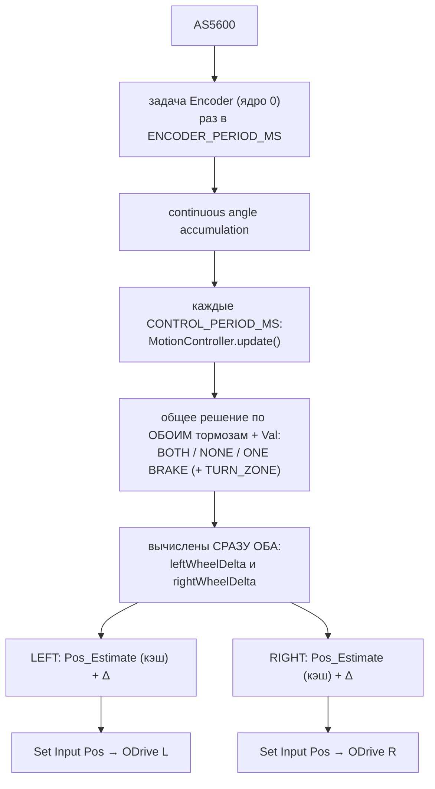

# Спецификация системы управления ELLIC (ESP32 + AS5600 + 2×ODrive), версия 3

**Прошивка ODrive:** v0.5.6 (ODESC 4.2, hw 3.6) · **Протокол связи с ODrive:** CAN Simple · **Прошивка ESP32:** v3.3

> Нормативный документ: здесь только то, чему код обязан соответствовать (алгоритм, константы,
> форматы, аппаратные подключения, принятые решения), плюс минимум контекста. Результаты исследований,
> открытые вопросы, планы и история — в `ELLIC_worklog.md`. Если раздел ссылается на открытый вопрос,
> смотри worklog и не додумывай поведение самостоятельно.

---

## 0. Модули и файлы

Каждый модуль — пара файлов `.h` / `.cpp` с тем же именем. В коде и спецификации используются только эти названия.

| Модуль | Файлы | Назначение |
|---|---|---|
| **Encoder** | Encoder.h/.cpp | Чтение AS5600 в отдельной задаче (ядро 0) раз в `ENCODER_PERIOD_MS`, накопление `continuousAngle`, восстановление шины I²C. `loop()` обращается к нему только через `getSnapshot()` |
| **MotionController** | MotionController.h/.cpp | `ValDelta`, логика тормозов и поворота, `leftWheelDelta` / `rightWheelDelta`; вызывается раз в `CONTROL_PERIOD_MS` |
| **ODriveCAN** | ODriveCAN.h/.cpp | Единственный владелец CAN-шины ODrive. Два логических канала по `node_id`: позиция и скорость колёс, кэш диагностики, online/offline, состояние контроллера TWAI |
| **BrakeInputs** | BrakeInputs.h/.cpp | Входы тормозов: опрос на каждом проходе `loop()`, программный фильтр, счётчики отброшенных импульсов. Сам ничего не отправляет |
| **FireButton** | FireButton.h/.cpp | Кнопка стрельбы: вход с подтяжкой, антидребезг, счётчик нажатий. Сама ничего не отправляет |
| **Telemetry** | Telemetry.h/.cpp | Сбор снапшотов, формирование пакета записей, вывод в Serial и BLE. К ODrive напрямую не обращается |
| **BleTelemetry** | BleTelemetry.h/.cpp | Передача уже сформированного текста по BLE (Nordic UART), в отдельной задаче на ядре 0. Сам текст не формирует |
| **main.cpp** | main.cpp | `setup()` и `loop()`: связывает модули и вызывает их по расписанию |
| *(опционально)* EllicVRButton | EllicVRButton.h/.cpp | BLE-геймпад. Сейчас отключён; одновременно с BleTelemetry использовать нельзя (один BLE-стек) |

Правила:

- Других классов для тех же функций (OdriveChannel, ODrive, MotorController и т.п.) нет.
- ODriveCAN — единственный владелец CAN-интерфейса. `main.cpp` содержит один его экземпляр, обслуживающий RIGHT (`node_id = 1`) и LEFT (`node_id = 2`).
- Telemetry, BleTelemetry, FireButton и BrakeInputs не управляют движением (BrakeInputs только отдаёт отфильтрованное состояние тормозов).
- Расхождение структуры кода с этим списком считается нарушением спецификации.

---

## 1. Физическая модель

- Один механический вал с датчиком **AS5600** (абсолютный энкодер, 0…360°).
- Вал через шагающий механизм связан с двумя мотор-колёсами; каждое управляется своим ODrive (LEFT / RIGHT).
- Левый и правый тормоза — органы управления поворотом (ESP32 читает их), а не механический стопор колеса.
- `MOTOR_GEAR_RATIO = 6.33`: при повороте вала на 360° мотор ODrive проворачивается на 6.33 оборота.
- Hall-датчик мотора (42 такта/оборот) в расчётах ESP32 не используется (его использует сам ODrive).

**Главный принцип:** вал — единственный источник движения. ESP32 сам движение не генерирует: человек двигает вал, ESP32 пересчитывает это в движение колёс.

---

## 2. Архитектура: общее решение по тормозам + независимые CAN-каналы

- **Расчёт приращений не независим по каналам.** Это одно общее решение на цикл управления: оно смотрит на оба тормоза и на общий `Val` (раздел 8) и сразу определяет оба приращения. Например, при нажатом только левом тормозе то же решение обнуляет `leftWheelDelta` и выставляет `rightWheelDelta = TURN_STEP × RIGHT_WHEEL_SIGN`.
- **Обмен по CAN — независимые каналы RIGHT и LEFT** через общий модуль ODriveCAN. Ошибка или отсутствие ответа одного канала не блокирует другой.



---

## 3. Переменные и терминология

| Объект | Переменная | Смысл |
|---|---|---|
| Val | raw-угол AS5600 | 0…360°, последнее валидное значение датчика |
| Val | `continuousAngle` | накопленный (безразрывный) угол вала |
| Val | `ValDelta` | изменение `continuousAngle` между двумя циклами `MotionController.update()`, умноженное на `ENCODER_SIGN` |
| LeftWheel | `leftWheelDelta` | приращение для ODrive L (обороты вала мотора, до редуктора) |
| RightWheel | `rightWheelDelta` | приращение для ODrive R |
| ODrive (L/R) | `Pos_Estimate` | последняя позиция, принятая по CAN (кэш в ODriveCAN) |

Накопленной цели (target) в ESP32 **нет**: новая команда всегда строится от последней принятой позиции колеса. Если дельта не была учтена (пропуск цикла и т.п.), она теряется, накопления ошибки не происходит. Это принятое решение (защита от накопления цели при заблокированном колесе). Альтернатива «цель в ESP» рассмотрена и отложена — см. worklog, D2.

---

## 4. Аппаратные подключения (ESP32)

**Питание ESP32:** от основной батареи (~40 В) через понижающий преобразователь до 5 В.

**AS5600 (I²C):**

| Сигнал | Пин |
|---|---|
| SDA | GPIO21 |
| SCL | GPIO22 |
| I²C clock | 50 кГц (`Wire.setClock(50000)`) |
| Адрес / регистр | 0x36 / RAW ANGLE 0x0C (12 бит) |

**Тормоза** (`INPUT_PULLUP`, второй провод на землю): LEFT_BRAKE_PIN = GPIO32, RIGHT_BRAKE_PIN = GPIO33. Тормоз нажат при LOW на пине **после программного фильтра** (раздел 8.4): состояние принимается, когда сырой уровень не менялся не менее `BRAKE_DEBOUNCE_MS`.

**Внешние подтяжки (рекомендуется, v3.3).** Внутренняя подтяжка ESP32 слабая (~45 кОм), и длинный провод рядом с силовыми цепями ловит помехи: по логам тормоза ложно срабатывали сразу оба (общая помеха). Ставятся резисторы на 3.3 В (вывод 3V3 платы ESP32), как можно ближе к пинам ESP32; внутренние подтяжки остаются включёнными:

| Линия | Подтяжка к 3.3 В |
|---|---|
| Левый тормоз, GPIO32 | 4.7 кОм |
| Правый тормоз, GPIO33 | 4.7 кОм |
| Кнопка стрельбы / синий провод Nerf, GPIO23 | 10 кОм (мягче, чтобы не нагружать цепь триггера Nerf; проверить, что Nerf стреляет и не срабатывает сам; при проблемах убрать) |
| SDA / SCL AS5600 | 4.7 кОм (уже стоят) |

Токи в нажатом состоянии: 0.7 мА (4.7 кОм) и 0.33 мА (10 кОм), для контактов выключателей это нормально. Если ложные срабатывания останутся, дополнительно можно поставить конденсатор 100 нФ между пином тормоза и GND (у ESP32). Провода: каждый тормоз витой парой (сигнал + возврат на GND ESP32 в точке рядом с платой, а не на раму или минус батареи), трассу вести подальше от фазных проводов моторов и ODrive, пересекать их под 90°, разъёмы обжать и проверить.

**CAN:** встроенный TWAI ESP32, трансивер SN65HVD230, TX = GPIO16, RX = GPIO17, 250000 бит/с. Оба ODrive на одной шине: RIGHT `node_id = 1`, LEFT `node_id = 2`. Терминаторы 120 Ом на концах шины (≈60 Ом между CAN_H и CAN_L при выключенном питании), общая земля.

**Кнопка стрельбы:** GPIO23, `INPUT_PULLUP`, нажата при `digitalRead(pin) == LOW`. Пин выбран как свободный и безопасный: не занят AS5600, тормозами и CAN, не strapping-пин; GPIO18 зарезервирован под EllicVRButton, GPIO27 — под джойстик, GPIO25/26 — бывшие UART-линии ODrive.

Подключение (принятая схема, дополнительных деталей нет):

| Что | Куда |
|---|---|
| Синий провод Nerf | GPIO23 |
| Фиолетовый провод Nerf | GND ESP32 |
| Кнопка без фиксации | между GPIO23 и GND ESP32 |

Нажатие кнопки замыкает синий провод на фиолетовый: Nerf стреляет, а ESP32 видит LOW. Требования:

- Nerf питается от своих батареек. Силовые провода ELLIC с ним не соединяются.
- Минус батареек Nerf **нигде не соединяется с землёй ESP32/ELLIC**: ни проводом, ни через раму, ни через общее питание. Иначе фиолетовый провод окажется прижат к нулю, и Nerf перестанет стрелять. Проверка: прозвонить мультиметром между минусом батареек Nerf и GND ESP32 — цепь должна быть разомкнута.
- **Проверка перед первым подключением:** с установленными батарейками Nerf, не подключая ESP32, измерить напряжение между синим и фиолетовым проводами. Оно не должно превышать 3.3 В (абсолютный максимум входа ESP32 около 3.6 В); при большем значении синий провод напрямую к GPIO23 подключать нельзя.
- Резистор 330 Ом последовательно с GPIO23 и конденсатор 100 нФ между GPIO23 и GND сейчас не ставятся. При ложных срабатываниях их можно добавить; программно можно увеличить `FIRE_DEBOUNCE_MS`.

**Serial:** `SERIAL_BAUD` = 921600 (в `platformio.ini`: `monitor_speed = 921600`).

---

## 5. Константы (Config.h)

| Константа | Значение | Назначение |
|---|---|---|
| `CONTROL_PERIOD_MS` | 300 мс | период `MotionController.update()` и отправки команд |
| `MOTOR_GEAR_RATIO` | 6.33 | вал → мотор ODrive |
| `TURN_ZONE_DEG` | 10.0° | ширина зоны поворота |
| `TURN_STEP` | 0.7 оборота мотора | приращение противоположного колеса при повороте |
| `ENCODER_SIGN` | −1.0 | направление энкодера (применяется к `ValDelta`) |
| `LEFT_WHEEL_SIGN` / `RIGHT_WHEEL_SIGN` | +1.0 / −1.0 | знаки каналов (моторы зеркальны) |
| `ENCODER_PERIOD_MS` | 10 мс | период опроса AS5600 (в задаче Encoder) |
| `ENCODER_RESYNC_MS` | 100 мс | пауза в чтении датчика, после которой первое успешное чтение только перепривязывает точку отсчёта |
| `AS5600_I2C_TIMEOUT_MS` | 20 мс | таймаут транзакции I²C (`Wire.setTimeOut`) |
| `CAN_STALL_GUARD_MS` | 350 мс | пауза между вызовами `ODriveCAN::update()`, после которой позиции колёс сбрасываются |
| `FIRE_BUTTON_PIN` | 23 | вход кнопки стрельбы |
| `BRAKE_DEBOUNCE_MS` | 30 мс | фильтр тормозов: время, которое сырой уровень должен не меняться |
| `FIRE_DEBOUNCE_MS` | 15 мс | антидребезг кнопки стрельбы |
| `FIRE_SEND_IMMEDIATE` | 0 | 1 — дополнительно выдавать строку M сразу при смене состояния кнопки |
| `TELEMETRY_PERIOD_MS` | 200 мс | период сбора и печати пакета |
| `TELEMETRY_TO_SERIAL` | 1 | дублировать телеметрию в Serial |
| `SERIAL_BAUD` | 921600 | скорость Serial |
| `CAN_NODE_STALE_MS` | 300 мс | порог offline и «протухшей» позиции |
| `TWAI_RX_QUEUE_LEN` / `TWAI_TX_QUEUE_LEN` | 64 / 16 | очереди драйвера TWAI |
| `CAN_STATUS_POLL_MS` | 50 мс | период опроса состояния TWAI |
| `RIGHT_ODRIVE_NODE_ID` / `LEFT_ODRIVE_NODE_ID` | 1 / 2 | CAN node_id |

---

## 6. Encoder: вычисление угла

### 6.1. Уровень энкодера

AS5600 опрашивается **в отдельной задаче FreeRTOS на ядре 0** (приоритет выше BLE-задачи) раз в `ENCODER_PERIOD_MS` (10 мс, 100 Гц). Результат (`rawAngle`, `continuousAngle`, `lastDelta`, счётчики) публикуется под защитой критической секции; `loop()` читает его через `getSnapshot()` и к `Wire` не обращается. Причина: транзакция I²C с датчиком иногда зависала ровно на ~1 с (по логам v3.1), а пока она не возвращалась, весь `loop()` стоял: не принимался CAN, не уходили команды колёсам. Теперь такое зависание задерживает только задачу энкодера. Вал на 10 мс проходит единицы градусов, порог неоднозначности 180° недостижим.

```
delta = currentRawAngle − previousRawAngle
если delta > 180°: delta −= 360°
если delta < −180°: delta += 360°
continuousAngle += delta
```

Коррекция перехода через 0°/360° обязательна: 359° → 1° это +2°, а не −358°.

Первое успешное чтение фиксирует точку отсчёта: `continuousAngle = 0`, дельта не считается.

### 6.2. Уровень контроллера движения

`MotionController.update()` раз в `CONTROL_PERIOD_MS`:

```
ValDelta = (continuousAngle_now − continuousAngle_previous_control_cycle) × ENCODER_SIGN
```

На первом цикле `ValDelta = 0`, точка отсчёта фиксируется.

### 6.3. Обработка ошибок AS5600

При ошибке чтения I²C (`endTransmission() != 0` или `requestFrom()` вернул менее 2 байт):

- `continuousAngle` и `previousRawAngle` НЕ обновляются;
- снапшот отдаёт последнее валидное значение;
- ошибка считается в счётчике `readErrors` (в телеметрии — событие `ERR AS5600`, раздел 13). В лог текстом не пишется.

После **любой** неудачной попытки чтения задача восстанавливает шину I²C: `Wire.end()`, до 9 тактов на SCL, пока датчик удерживает SDA низким, условие STOP, `Wire.begin()`, `setClock()`, `setTimeOut()`. Число восстановлений выдаётся в записи D (`asRecov`). Если датчик не отвечает больше 3 попыток подряд, повторы идут раз в 100 мс.

**Перепривязка после паузы.** Если от последнего успешного чтения прошло больше `ENCODER_RESYNC_MS` (100 мс), первое успешное чтение только запоминает новый `previousRawAngle` и обнуляет `lastDelta`, а дельта не считается: что вал делал за это время, неизвестно, а при повороте больше 180° коррекция перехода дала бы неверное направление. Движение вала за время паузы, как и любая другая не учтённая дельта (раздел 3), теряется.

`0°` — валидное значение, не признак ошибки. Других автоматических реакций на ошибки AS5600 нет (ни остановка, ни сброс угла, ни аварийное состояние): управление построено на приращениях, одиночный сбой не накапливается, следующее валидное чтение (в пределах `ENCODER_RESYNC_MS`) продолжает накопление. Автокоррекции медленного дрейфа нет; этот риск принят осознанно, контроль — пилот через тормоза и выключение питания.

Длительность чтения измеряется (`readMaxUs` в записи D) для диагностики блокировок I²C.

---

## 7. Базовое движение — ни один тормоз не нажат

```
leftWheelDelta  = ValDelta × MOTOR_GEAR_RATIO / 360 × LEFT_WHEEL_SIGN
rightWheelDelta = ValDelta × MOTOR_GEAR_RATIO / 360 × RIGHT_WHEEL_SIGN
```

Знаки каналов компенсируют зеркальную установку моторов.

---

## 8. Логика тормозов и поворота

Порядок проверок на каждом цикле фиксирован: (1) оба нажаты, (2) ни один, (3) только левый, (4) только правый. В ветках «один тормоз» дополнительно проверяется `TURN_ZONE`.

### 8.1. Зона поворота (TURN_ZONE)

Две зоны шириной `TURN_ZONE_DEG` вокруг опорных точек: **170°…190°** и **350°…360° / 0°…10°** (с корректным оборачиванием). Проверяется по raw-углу `Val`. Примеры: 358° и 2° — в зоне; 349° и 11° — вне зоны.

### 8.2. Алгоритм

| Условие | Режим | leftWheelDelta | rightWheelDelta |
|---|---|---|---|
| оба нажаты | CALM | 0 | 0 |
| ни один | NORMAL (раздел 7) | по разделу 7 | по разделу 7 |
| только левый, `Val` вне зоны | CALM | 0 | 0 |
| только левый, `Val` в зоне | TURN | 0 | `TURN_STEP × RIGHT_WHEEL_SIGN` |
| только правый, `Val` вне зоны | CALM | 0 | 0 |
| только правый, `Val` в зоне | TURN | `TURN_STEP × LEFT_WHEEL_SIGN` | 0 |

### 8.3. CALM

CALM формирует нулевые приращения, но команда на ODrive всё равно отправляется (раздел 9): ODrive получает собственную текущую позицию как новую цель. Отдельного state machine нет: режим определяется заново на каждом цикле по текущим входам.

### 8.4. Фильтр тормозов

Состояния `leftBrake` / `rightBrake` для раздела 8.2 берутся из `BrakeInputs`, а не прямым чтением пинов. Модуль опрашивает пины на каждом проходе `loop()` и меняет состояние тормоза, только когда сырой уровень не менялся не менее `BRAKE_DEBOUNCE_MS` (30 мс). Намеренное нажатие тормоза длится сотни миллисекунд, поэтому задержка 30 мс незаметна. Импульсы короче `BRAKE_DEBOUNCE_MS` отбрасываются (в обе стороны: ложное нажатие и ложное отпускание) и считаются; ширина самого длинного за период запоминается.

Причина: по логу от 22.10 за 12 с неподвижности было три ложных «оба тормоза» (по одному чтению в цикле управления, прежде тормоза читались одним `digitalRead` раз в 300 мс). Ложное «оба тормоза» даёт CALM и потерянный цикл педалирования, а одиночный ложный тормоз при валу в `TURN_ZONE` повернул бы колесо на `TURN_STEP` без участия пилота.

Если ложные срабатывания остаются, а счётчики отброшенных импульсов нулевые, помеха длиннее фильтра: увеличить `BRAKE_DEBOUNCE_MS` (60–100 мс) и/или устранять причину в проводке.

---

---

## 9. Формирование команды на ODrive (MoveWheel)

Для **каждого** колеса, на каждом цикле управления, независимо от режима:

1. Взять последнюю принятую позицию колеса `Pos_Estimate` (из кэша ODriveCAN, пришла по CAN сообщением Get Encoder Estimates, `0x09`).
2. `newPosition = Pos_Estimate + wheelDelta`.
3. Отправить `Set Input Pos` (`0x0C`) с абсолютной позицией `newPosition`.

Формат кадра: CAN ID = `(node_id << 5) | 0x0C`, 8 байт: `float newPosition` (обороты), `int16 Vel_FF = 0`, `int16 Torque_FF = 0`.

Правила:

- **Позиция недоступна** (ни разу не получена) **или «протухла»** (возраст > `CAN_NODE_STALE_MS`) → команда для этого колеса в этом цикле не отправляется; счётчик `stale` (`rxFailCount`) растёт. Второе колесо не затрагивается.
- Отказ `twai_transmit()` → счётчик `txFail`.
- В момент каждой команды измеряется возраст позиции; максимум за период выдаётся в записи D (`ageL`, `ageR`).
- Команды `move_incremental` нет в CAN Simple fw 0.5.6; управление построено на абсолютной позиции.

Позиция вала (AS5600) и позиция колеса — разные величины: `leftWheelDelta` / `rightWheelDelta` всегда приращения от движения вала.

---

## 10. Конфигурация ODrive

ESP32 **не отправляет** конфигурацию ODrive в runtime (ни ASCII, ни CAN). Параметры задаются заранее через `odrivetool` по USB, сохраняются (`save_configuration()`) и бэкапятся (`backup-config`). Автоматической повторной конфигурации при потере связи нет.

| Параметр | Значение |
|---|---|
| `axis0.config.can.node_id` | RIGHT = 1, LEFT = 2 |
| `can.config.baud_rate` | 250000 |
| `axis0.config.can.heartbeat/encoder/iq/bus_vi/motor_error/encoder_error/controller_error_rate_ms` | 100 (все ненулевые) |
| `axis0.config.startup_closed_loop_control` | True (ODrive сам входит в closed loop при питании) |
| `axis0.config.enable_watchdog` | False (раздел 14) |
| `controller.config.control_mode` | 3 (POSITION_CONTROL) |
| `controller.config.input_mode` | 1 (PASSTHROUGH) |
| `controller.config.vel_limit` / `pos_gain` / `vel_gain` | 2 / 12 / 0.08 |
| `controller.config.vel_integrator_gain` / `vel_integrator_limit` | 0.3 / 0.57 |
| `controller.config.enable_gain_scheduling` | False |
| `controller.config.enable_torque_mode_vel_limit` | True |
| `encoder.config` (Hall) | mode 1, cpr 42, bandwidth 100, `pre_calibrated` True |
| `motor.config.current_lim` | 18 А (будет повышаться по плану worklog, раздел 8) |
| `config.dc_max_positive_current` / `dc_max_negative_current` | 15 / −5 А |

Значения моментов и токов — текущие рабочие; порядок их изменения и критерии — в worklog. Heartbeat (`0x01`) содержит `Axis_Error`, `Axis_State`, флаги ошибок и `Trajectory_Done_Flag`; `motor/encoder/controller error` приходят отдельными сообщениями (раздел 15).

---

## 11. Цикл `loop()` и тайминги

```
loop()
├── noteLoopGap(интервал с начала прошлого прохода)   ← диагностика
├── brakeInputs.update()       ← каждый проход (фильтр тормозов, раздел 8.4)
├── fireButton.update()        ← каждый проход (при FIRE_SEND_IMMEDIATE = 1 при смене состояния сразу telemetry.sendFireEvent())
│                                (AS5600 читается в отдельной задаче Encoder, раздел 6.1)
├── odriveCAN.update()         ← каждый проход: приём кадров, online/offline, состояние TWAI
├── bleTelemetry.update()      ← перезапуск рекламы после дисконнекта
├── прошло CONTROL_PERIOD_MS (300 мс)?
│    └── да → чтение тормозов → MotionController.update() → moveLeftWheel / moveRightWheel
└── telemetry.update()         ← свой период TELEMETRY_PERIOD_MS (200 мс)
```

Следствия: угол накапливается каждые 10 мс; решение «куда двигать колёса» принимается раз в 300 мс; суммарное изменение вала за эти 300 мс учитывается целиком в одном `ValDelta`. Приём CAN и телеметрия не блокируют друг друга в пределах возможностей железа; блокировка `loop()` измеряется (`loopGapMaxUs`).

---

## 12. Модуль ODriveCAN

### 12.1. Приём

На каждом проходе `loop()` ODriveCAN принимает все доступные кадры (без блокировки), определяет `node_id` и тип, обновляет кэш канала (позиция, скорость, Iq, Bus V/I, коды ошибок, флаги Heartbeat), метку времени последнего валидного кадра и **счётчики кадров по типам** (7 типов, раздел 13). Кадры от неизвестных `node_id` игнорируются.

### 12.2. Online / offline

- Канал online, если от `node_id` получен валидный кадр и с последнего прошло не больше `CAN_NODE_STALE_MS`; иначе offline. Следующий валидный кадр немедленно восстанавливает online.
- offline — только диагностическое состояние, не состояние управления. Повторная конфигурация не выполняется. Счётчики (`txCount`, `rxCount`, `rxFailCount`, …) при восстановлении не сбрасываются.
- RIGHT и LEFT независимы.

### 12.3. Контроллер TWAI

- Очередь приёма `TWAI_RX_QUEUE_LEN` = 64 кадра (по умолчанию в драйвере 5 — этого мало, два ODrive присылают по 7 кадров почти одновременно).
- Раз в `CAN_STATUS_POLL_MS` опрашивается состояние контроллера: состояние, TEC/REC, `rx_missed`, `arb_lost`, `bus_error`, `tx_failed`.
- **bus-off:** при `TWAI_STATE_BUS_OFF` запускается `twai_initiate_recovery()` (один раз на эпизод, счётчик `busOffRecov`); когда драйвер перешёл в `STOPPED` — `twai_start()`.
- **Защита от паузы `loop()`.** Если между двумя вызовами `ODriveCAN::update()` прошло больше `CAN_STALL_GUARD_MS` (350 мс), очередь приёма сбрасывается (`twai_clear_receive_queue()`), а позиции обоих колёс объявляются недействительными до следующего кадра `0x09` (команды колёсам в эти циклы не уходят, счётчик `stale` растёт). Причина: метка времени кадра ставится при обработке, а не при приёме, а при переполнении очереди теряются самые **новые** кадры, так что после длинной паузы в кэш попали бы самые старые кадры, помеченные как свежие, и колесо получило бы цель от устаревшей позиции. Тот же сброс выполняется, если `rx_missed` драйвера вырос без пойманной паузы. Паузу не считать потерей связи с узлом: `lastFrameMs` обновляется. Число сбросов выдаётся в записи D (`canStalls`).
- Если драйвер не удалось установить, команды не отправляются, приём пропускается (в телеметрии это видно как отсутствие кадров).

### 12.4. Приоритет движения

Обработка входящих кадров не должна ждать телеметрию, Serial или BLE. MoveWheel не ждёт диагностических кадров. Telemetry только читает кэш ODriveCAN.

---

## 13. Телеметрия (протокол v3)

### 13.1. Транспорт

Раз в `TELEMETRY_PERIOD_MS` `Telemetry` собирает снапшоты и формирует **один текстовый пакет** (записи M, L, R, E, D, C, по строке на запись, `\n`, поля через запятую, имён полей нет), затем выдаёт его одним вызовом:

- Serial (`TELEMETRY_TO_SERIAL`, 921600 бод);
- BLE через BleTelemetry.

BLE: Nordic UART Service (`6e400001-b5a3-f393-e0a9-e50e24dcca9e`; TX-характеристика `...0003...`, notify). Пакет кладётся в очередь одним элементом (до 800 байт, очередь 6 пакетов), `send()` никогда не блокирует; отправка — в отдельной задаче на ядре 0, кусками по 180 байт с паузой 5 мс. При переполнении теряются целые пакеты, а не обрывки строк. Управление моторами от состояния Bluetooth не зависит. Служебные строки прошивки в Serial начинаются с `#` (например, баннер при старте) и приёмником игнорируются.

### 13.2. Записи

Первое поле — тип, второе — `ts` (`millis()` ESP32, мс на момент сбора). Все «за период» значения — число событий с прошлой выдачи (не накопительные).

**M — вал, движение и кнопка стрельбы**

`M,ts,raw,cont,delta,valDelta,mode,flags,leftWheelDelta,rightWheelDelta,fire,fire_count`

`mode`: 0 NORMAL, 1 CALM, 2 TURN. `flags`: бит0 левый тормоз, бит1 правый тормоз, бит2 TURN_ZONE. Поля `fire` и `fire_count` добавлены в конец записи (формат остальных полей не менялся):

- `fire` — 1, если кнопка стрельбы нажата (состояние после антидребезга 15 мс), иначе 0;
- `fire_count` — число нажатий с запуска ESP32 (растёт по фронту нажатия, отпускание не считается; обнуляется при перезапуске ESP32). Если кнопка зажата в момент старта, это нажатием не считается.

**Как определять выстрел.** По умолчанию (`FIRE_SEND_IMMEDIATE = 0`) `fire` и `fire_count` уходят только в периодической записи M. Нажатие короче `TELEMETRY_PERIOD_MS` может не попасть в `fire` (в момент замера кнопка уже отпущена), поэтому выстрел следует определять **по росту `fire_count`**: разность между двумя принятыми пакетами даёт число выстрелов и не зависит от потерянных BLE-пакетов. Задержка выстрела в телеметрии — до одного периода (200 мс).

**Немедленная выдача (опция, `FIRE_SEND_IMMEDIATE = 1`).** В проход `loop()`, в который состояние `fire` изменилось, прошивка дополнительно, вне расписания, выдаёт одну строку M с текущими значениями (формат тот же, `ts` — момент события). Остальные записи в неё не входят, периодический график не сдвигается. Недостатки: лишние строки M между периодическими пакетами (разбор, который ожидает одну M на период или группирует записи по `ts`, получит неполную группу), возможное двойное срабатывание у потребителя, реагирующего на `fire = 1` вместо роста `fire_count`, и занятые слоты BLE-очереди при дребезге на линии. Приёмник старых прошивок (строка M из 10 полей) продолжает читаться.

**L / R — колесо**

`L,ts,online,state,traj,iq,vel,vbus,ibus,axisErr,motorErr,encErr,ctrlErr,tx,rx`

`state` — Axis_State (8 = closed loop), `iq` — Iq_Measured, А; `vel` — об/с; коды ошибок — hex; `tx`/`rx` — число кадров за период.

**E — события ошибок за период** (17 значений)

`E,ts,as5600,lTxFail,rTxFail,lStale,rStale,lOffline,rOffline,lAxisErr,rAxisErr,lMotErr,rMotErr,lEncErr,rEncErr,lCtrlErr,rCtrlErr,lBrakeGlitch,rBrakeGlitch`

`lBrakeGlitch`, `rBrakeGlitch` (v3.3) — число импульсов на входе левого/правого тормоза, отброшенных фильтром (короче `BRAKE_DEBOUNCE_MS`), за период.

`stale` — пропущенные команды (позиция недоступна/протухла). `AxisErr/MotErr/EncErr/CtrlErr` — новые ненулевые значения кода ошибки ODrive; постоянно висящая ошибка = одно событие, её код виден в записи L/R.

**D — система, TWAI и устойчивость** (20 значений)

`D,ts,uptimeS,reset,boots,prevUptimeS,loopGapMaxUs,sendUs,asReadMaxUs,twaiState,tec,rec,rxMissed,arbLost,busError,txFailedHw,busOffRecov,ageL,ageR,canStalls,asRecov,brakeGlitchMaxMs`

| Поле | Смысл |
|---|---|
| `uptimeS` | время работы текущего запуска, с |
| `reset` | `esp_reset_reason()` этого запуска (1 POWERON, 3 SW, 4 PANIC, 5 INT_WDT, 6 TASK_WDT, 7 WDT, 9 BROWNOUT) |
| `boots` | число запусков (RTC-память; обнуляется при полном отключении питания) |
| `prevUptimeS` | `uptimeS` предыдущего запуска на момент его последней выдачи |
| `loopGapMaxUs` | максимум интервала между началами проходов `loop()` за период, мкс |
| `sendUs` | длительность предыдущей выдачи пакета, мкс |
| `asReadMaxUs` | максимум длительности чтения AS5600 за период, мкс |
| `twaiState` | 0 STOPPED, 1 RUNNING, 2 BUS_OFF, 3 RECOVERING |
| `tec`, `rec` | счётчики ошибок TWAI (текущие значения) |
| `rxMissed`, `arbLost`, `busError`, `txFailedHw`, `busOffRecov` | события TWAI за период |
| `ageL`, `ageR` | максимум возраста позиции в момент команды за период, мс (65535 = позиции ещё не было) |
| `canStalls` | сколько раз за период позиции колёс сбрасывались после паузы `loop()` или потери кадров (v3.2) |
| `asRecov` | сколько раз за период восстанавливалась шина I²C AS5600 (v3.2) |
| `brakeGlitchMaxMs` | максимальная ширина импульса, отброшенного фильтром тормозов, за период, мс (v3.3; разрешение ~ длительность прохода `loop()`, единицы мс) |

**C — кадры ODrive по типам за период** (14 значений)

`C,ts, L[hb,motErr,encErr,est,iq,busVI,ctrlErr], R[hb,motErr,encErr,est,iq,busVI,ctrlErr]`

Типы по порядку: Heartbeat `0x01`, Motor Error `0x03`, Encoder Error `0x04`, Encoder Estimates `0x09`, Iq `0x14`, Bus V/I `0x17`, Controller Error `0x1D`. Норма при `rate_ms = 100` и периоде 200 мс: по 2 кадра каждого типа (допустимо ±1).

### 13.3. Приёмник

`tools/EllicBleTelemetryBrowser.html` — один файл без внешних библиотек: Web Bluetooth (Chrome/Edge), онлайн-графики всех числовых величин и статусов на одной панели (окно 30 с / 1 мин / 5 мин / всё, пауза), экспорт в `.xlsx` (время слева направо, по строке на переменную, ошибки внизу) и сохранение сырого лога `.txt`. Ось времени строится по `ts` устройства; перезагрузка ESP32 ось не рвёт. Графики событий (кадры CAN по типам, ошибки, тормоза) рисуются так: каждая серия в своей строке напротив своей подписи, только точки, **размер точки — число событий за пакет**; перекрывать друг друга серии не могут. Режим движения показывается цветными отрезками: зелёный — едет прямо (NORMAL), жёлтый — поворачивает (TURN), красный — стоит (CALM); других режимов нет. Тормоза — две строки точек: «1 · правый», «2 · левый» (отпущенный тормоз не рисуется). `TURN_ZONE` — точка только там, где вал в зоне поворота (вне зоны ничего не рисуется). Кнопка стрельбы показывается отдельной секцией: состояние `fire` и счётчик `fire_count`. Строки по умолчанию упорядочены по показателю, внутри показателя сначала правое колесо, потом левое; порядок можно менять перетаскиванием за левый край строки — он запоминается в браузере и дополнительно сохраняется/загружается файлом раскладки (`ellic_layout.json`); строки Excel следуют порядку на экране. Ранее сохранённые логи (`.xlsx` из этого просмотрщика, в том числе из прежних версий, и сырой `.txt`; можно сразу несколько частей) открываются кнопкой «Открыть лог» в режиме просмотра с ползунком положения окна (Shift + колесо мыши — то же). Кнопка «Демо» воспроизводит формат без железа.

### 13.4. Снапшоты (внутренняя структура)

Модуль-владелец отдаёт данные через `getSnapshot()`, Telemetry держит только пред. значения счётчиков для вычисления событий за период. Состав: `EncoderSnapshot` (raw, cont, lastDelta, readErrors, readMaxUs, busRecoveries), `MotionSnapshot`, `FireSnapshot` (pressed, pressCount), `BrakeSnapshot` (состояния после фильтра, счётчики отброшенных импульсов), `OdriveSnapshot` ×2 (в том числе `cmdCount[7]`, `posAgeMaxMs`), `CanBusSnapshot` (в том числе `posInvalidations`).

Непрерывным источником истины при тестах считается Serial-лог на ПК (BLE-канал может терять пакеты и используется для просмотра).

---

## 14. Обработка ошибок и принятые решения по безопасности

- **Единственное влияние ошибки связи на управление:** если позиция колеса недоступна или протухла, команда для этого колеса не отправляется (раздел 9). Второе колесо работает независимо.
- **Ошибки ODrive** (`axis/motor/encoder/controller error`) только выводятся в телеметрию; автоматических действий (остановка, сброс, переход в другое состояние) нет. ODrive сам переходит в IDLE/DISARMED по своим защитам.
- **Watchdog ODrive выключен** (`enable_watchdog = False`). Принятое поведение при потере управления — **удержание последней позиции**, а не свободное вращение (у механизма нет независимого стопора, на уклоне свободное колесо может покатиться). Наблюдаемая цена этого решения — при остановке ESP педали тяжёлые, а повороты не работают. Решение подлежит пересмотру после диагностики причины остановки (worklog, P2/P6/D8).
- **Ошибки AS5600** — раздел 6.3 (не накапливаются, автоматических действий нет).
- **offline канала** — диагностика (раздел 12.2); автоматической реконфигурации нет.
- **Bus-off TWAI** — автоматическое восстановление (раздел 12.3).
- Автоматической компенсации дрейфа AS5600, остановки обоих ODrive и аварийного состояния нет; контроль — пилот (тормоза, выключение питания).

---

## 15. CAN Simple: используемые сообщения (fw 0.5.6)

CAN ID = `(node_id << 5) | command_id`. RIGHT = node 1, LEFT = node 2.

| Command ID | Сообщение | Направление |
|---|---|---|
| `0x01` | Heartbeat (Axis_Error u32, Axis_State u8, флаги) | ODrive → ESP |
| `0x03` | Get Motor Error (u64) | ODrive → ESP |
| `0x04` | Get Encoder Error (u32) | ODrive → ESP |
| `0x09` | Get Encoder Estimates (Pos_Estimate, Vel_Estimate; float, float) | ODrive → ESP |
| `0x0C` | Set Input Pos (float pos, int16 Vel_FF, int16 Torque_FF) | ESP → ODrive |
| `0x14` | Get Iq (Iq_Setpoint, Iq_Measured; float, float) | ODrive → ESP |
| `0x17` | Get Bus Voltage/Current (float, float) | ODrive → ESP |
| `0x1D` | Get Controller Error (u32) | ODrive → ESP |

Не используются: Vq (отдельного сообщения в fw 0.5.6 нет), Procedure_Result (в Heartbeat 0.5.6 отсутствует), любые инкрементные команды (в CAN Simple 0.5.6 их нет).

---

## 16. Принятые ограничения и риски

- Нет автокоррекции дрейфа AS5600 и нет аварийного состояния (раздел 6.3, 14).
- Позиция для расчёта цели имеет возраст 0–100 мс (период рассылки `Pos_Estimate`); часть пройденного колесом пути за этот возраст в цикле «теряется». Рассмотренная альтернатива (накопление цели в ESP) отложена до результатов диагностики (worklog, D2).
- BLE-телеметрия может терять пакеты; для полного непрерывного лога использовать Serial.
- Управление дискретно с шагом `CONTROL_PERIOD_MS`.
- Калибровка привязки зон поворота к физическим положениям вала (worklog, раздел 9) не выполнена.

---

## Приложение А. Изменения v2 → v3

| Область | v2 | v3 |
|---|---|---|
| Опрос AS5600 | на каждом проходе `loop()` | раз в 10 мс |
| Очередь приёма TWAI | 5 (по умолчанию) | 64; обработка bus-off |
| Период телеметрии | 100 мс | 200 мс |
| Serial | 115200 | 921600 |
| BLE | очередь по одной строке (24), `notify` на строку | пакет целиком одним элементом, ~3 `notify` на пакет |
| Записи телеметрии | M, L, R, E | M, L, R, E + **D** (система, TWAI, возраст позиции) + **C** (кадры по типам) |
| Диагностика перезапусков | нет | `reset`, `boots`, `prevUptimeS` (RTC-память) |
| Спецификация | нормативный текст + расхождения с кодом | приведена в соответствие с кодом (в т.ч. `ENCODER_SIGN`, `startup_closed_loop_control`, `input_mode = 1`) |
| Не менялось | алгоритм движения, тормоза, поворот, формат M/L/R/E, MotionController, EllicVRButton | |

## Приложение Б. Изменения v3.0 → v3.1

| Область | v3.0 | v3.1 |
|---|---|---|
| Кнопка стрельбы | нет | модуль FireButton, GPIO23, антидребезг 15 мс, счётчик нажатий |
| Запись M | 10 полей | 12 полей: в конец добавлены `fire`, `fire_count` |
| Выдача | только периодический пакет | то же; опционально (`FIRE_SEND_IMMEDIATE = 1`) + строка M сразу при изменении состояния кнопки |
| Просмотрщик | — | секция «Кнопка стрельбы»; читает M из 10 и 12 полей; новые строки встают рядом с соседями в сохранённом порядке |
| Подключение кнопки | — | синий провод Nerf → GPIO23, фиолетовый → GND ESP32, кнопка между GPIO23 и GND; минус батареек Nerf с землёй ESP32/ELLIC не соединяется |
| Не менялось | алгоритм движения, тормоза, поворот, ODriveCAN, формат записей L, R, E, D, C | |

## Приложение В. Изменения v3.1 → v3.2

| Область | v3.1 | v3.2 |
|---|---|---|
| Чтение AS5600 | в `loop()`, зависание I²C на ~1 с останавливало весь цикл (CAN, команды) | отдельная задача на ядре 0; `loop()` читает только `getSnapshot()` |
| Ошибка чтения I²C | счётчик ошибок | + восстановление шины (9 тактов SCL, STOP, переинициализация Wire), повторы раз в 100 мс при длительной потере датчика |
| Пауза в чтении датчика > 100 мс | первое чтение считало дельту (риск неверного направления при повороте > 180°) | первое чтение только перепривязывает точку отсчёта |
| Пауза `loop()` > 350 мс или рост `rx_missed` | кадры из переполненной очереди принимались как свежие | очередь сбрасывается, позиции недействительны до следующего кадра `0x09` |
| Запись D | 19 полей | 21 поле: в конец добавлены `canStalls`, `asRecov` (просмотрщик читает и 19) |
| `Encoder::update()` | вызывалась в `loop()` | удалён |
| Не менялось | алгоритм движения, тормоза, поворот, кнопка стрельбы, формат M, L, R, E, C | |

## Приложение Г. Изменения v3.2 → v3.3

| Область | v3.2 | v3.3 |
|---|---|---|
| Чтение тормозов | `digitalRead` раз в цикл управления (300 мс), без фильтрации | модуль BrakeInputs: опрос на каждом проходе `loop()`, фильтр 30 мс, счётчики отброшенных импульсов |
| Запись E | 17 полей | 19 полей: в конец добавлены `lBrakeGlitch`, `rBrakeGlitch` (просмотрщик читает и 17) |
| Запись D | 21 поле | 22 поля: в конец добавлено `brakeGlitchMaxMs` (просмотрщик читает и 19, 21) |
| Проводка | подтяжки только на I²C | рекомендованы внешние подтяжки на тормоза (4.7 кОм) и кнопку стрельбы (10 кОм), раздел 4 |
| Не менялось | алгоритм движения, поворот, ODriveCAN, Encoder, кнопка стрельбы, формат M, L, R, C | |
